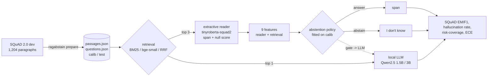

# ragabstain: answer or abstain, hallucination control for RAG on SQuAD 2.0

[](https://github.com/Adversitas/rag-answerability/actions/workflows/ci.yml)

A RAG assistant over internal documents is judged less on the questions it answers well than
on the ones it should not answer at all: the information is not in the documents, but a
passage *looks* relevant and the system confidently produces something. This project measures
that failure mode and compares ways to control it, on a benchmark built for it.

- **Data**: the official **SQuAD 2.0 dev set**. Every one of its 1,204 Wikipedia paragraphs
  is the document store; questions are a balanced sample of 2,000 (1,000 answerable, 1,000
  *unanswerable*: written by crowd workers to look answerable from a paragraph that does not
  contain the answer). Split 50/50 into a **calibration** half (every threshold and the gate
  are fitted there) and a **test** half (all numbers below).
- **Pipeline**: retrieval (BM25 from scratch, dense `BAAI/bge-small-en-v1.5`, hybrid RRF) →
  extractive reader `deepset/tinyroberta-squad2` over the top 3 passages, which returns the
  best span *and* a "no answer" score → decide whether to answer.
- **Abstention policies**: always answer; the reader's default rule (span score > null
  score); the same margin with a threshold tuned on the calibration half; and a **learned
  answerability gate** (logistic regression on 9 reader and retrieval signals: margin, span
  and null scores, span probability, retrieval score and gap, rank of the chosen passage,
  answer length, question overlap with the answer sentence).
- **Generative baseline**: a local LLM (Qwen2.5 1.5B and 3B Instruct) told to answer from the
  passage or reply `UNANSWERABLE`, alone and behind the gate.
- **Metrics**: official SQuAD 2.0 EM / F1 (abstaining on an unanswerable question counts as
  correct), **hallucination rate** = share of unanswerable questions that still get an answer,
  answer rate, risk-coverage curve (AURC) and calibration (ECE) of the gate.

## Results

Hybrid retrieval, 1,000 test questions (full tables for BM25, hybrid and an oracle that gets
the gold paragraph: [`reports/results.md`](reports/results.md)).

| Policy | F1 | EM | Answerable F1 | Hallucination rate | Answer rate |
|---|---|---|---|---|---|
| Always answer | 0.403 | 0.376 | **0.806** | 1.000 | 1.000 |
| Reader default (margin > 0) | 0.742 | 0.720 | 0.763 | 0.278 | 0.580 |
| Reader margin, threshold tuned on calibration | 0.763 | 0.744 | 0.693 | **0.166** | 0.472 |
| **Learned answerability gate** | **0.777** | **0.756** | 0.739 | 0.186 | 0.511 |
| *Oracle passage, tuned margin* | *0.818* | *0.799* | *0.772* | *0.136* | *0.483* |

Passage retrieval (answerable questions): hybrid R@1 0.801 / R@3 0.930 / R@5 0.955, BM25
0.793 / 0.912 / 0.933, dense bge-small 0.715 / 0.868 / 0.914.

Generative reader on 300 balanced test questions (150 answerable, 150 unanswerable), top-1
hybrid passage:

| Reader | F1 | Answerable F1 | Hallucination rate | Median latency |
|---|---|---|---|---|
| Qwen2.5-1.5B-Instruct alone | 0.503 | 0.705 | 0.700 | 0.68 s |
| Qwen2.5-3B-Instruct alone | 0.603 | 0.673 | 0.467 | 17.2 s* |
| **Extractive reader + learned gate** (top-3) | **0.807** | **0.754** | 0.140 | 0.07 s |
| Gate, then Qwen 1.5B on the questions it lets through | 0.763 | 0.632 | 0.107 | |
| Gate, then Qwen 3B | 0.755 | 0.603 | **0.093** | |

\* Measured on an 8 GB laptop GPU (RTX 4060) where the 3B model in bf16 barely fits; the
latency most likely includes spill-over into shared memory and says little about the model.

What the numbers say:

- **Answering everything is the real risk, not wrong answers.** The reader scores 0.81 F1 on
  answerable questions, but without abstention every unanswerable question
  gets an answer: overall F1 0.40.
- **The model's built-in "no answer" rule is not enough out of the box.** It still answers 28 %
  of unanswerable questions. Simply **tuning its threshold on 1,000 held-out questions** cuts
  that to 17 % and gains 2 F1 points. That is the cheapest and largest step.
- **The learned gate adds little on top, and only because of retrieval.** +1.4 F1 points
  over the tuned threshold with hybrid retrieval, +0.5 with BM25, and none with the oracle
  passage (0.811 vs 0.818). Its largest coefficients after the reader margin are the rank of
  the passage the answer came from (-0.70) and the retrieval gap: it learns "an answer found in
  the 3rd passage is suspicious", which only matters when retrieval is uncertain. Its
  probabilities are well calibrated (ECE 0.034), which makes the threshold easy to explain to
  a business owner ("answer only when the gate is ≥ 34 % sure").
- **Retrieval costs about 4 F1 points** (0.777 hybrid vs 0.811-0.818 with the gold paragraph).
  BM25 is almost as good as hybrid here because SQuAD questions reuse the paragraph's words;
  the dense model alone is the weakest retriever.
- **Small LLMs hallucinate on unanswerable questions despite the instruction.** Qwen 1.5B
  answers 70 % of them, 3B still 47 %, against 14 % for the extractive reader with its gate.
  Putting the gate *in front of* the LLM gives the lowest hallucination rate of all (9-11 %),
  but lower F1 than the extractive reader because the LLM paraphrases (SQuAD scoring rewards
  exact spans) and sees one passage instead of three. For a document assistant, "gate first,
  then generate" is the pattern to keep; the gate is also what lets the system say *why* it
  declined.

## Architecture



| Module | Role |
|---|---|
| [`data.py`](src/ragabstain/data.py) | Downloads SQuAD 2.0 dev, builds the passage store and the balanced calib/test sample. |
| [`retrieval.py`](src/ragabstain/retrieval.py) | BM25 (from scratch), bi-encoder, Reciprocal Rank Fusion. |
| [`reader.py`](src/ragabstain/reader.py) | Extractive reader with windowing; best span and null score per passage. |
| [`pipeline.py`](src/ragabstain/pipeline.py) | Retrieve → read → features; tunes and evaluates every policy (calibration vs test). |
| [`llm.py`](src/ragabstain/llm.py) | Local chat model as a generative reader, abstention parsing. |
| [`metrics.py`](src/ragabstain/metrics.py) | Official SQuAD normalisation, EM/F1, hallucination rate, risk-coverage/AURC, ECE. |

## How to run

```bash
pip install -e ".[models,dev]"
ragabstain prepare                       # download SQuAD 2.0 dev (4 MB), rebuild data/*.json
ragabstain retrieval                     # recall@k of bm25 / dense / hybrid
ragabstain run --retriever hybrid        # reader + policies -> reports/abstention_hybrid.json
ragabstain run --retriever bm25
ragabstain run --oracle                  # gold paragraph only: the reader's ceiling
ragabstain llm --model Qwen/Qwen2.5-1.5B-Instruct -n 300
ragabstain report                        # reports/results.md
```

The sampled passages and questions are committed (`data/`), as are the experiment outputs
(`reports/*.json`). CI runs ruff, the tests (data parsing and sampling, metrics against hand-computed SQuAD
cases, BM25 and fusion, span selection, the full pipeline and policy tuning on toy data with
a fake reader, the LLM output parser, the report), BM25 retrieval on the committed sample, and rebuilds the
results page.

## Limitations

- SQuAD 2.0 unanswerable questions are adversarial *for a given paragraph*; in a real store the
  missing information is often missing from the whole corpus, which is easier to detect from
  retrieval scores. Absolute rates will differ; the comparison between policies is the point.
- Single sample of 2,000 questions and one calibration/test split; differences of about one F1
  point (gate vs tuned threshold) are within what a different split could change.
- The LLM comparison is not like-for-like on context (one passage for the LLM, three for the
  extractive reader) and SQuAD F1 penalises correct paraphrases, so it understates LLM answer
  quality on answerable questions. The hallucination rate is not affected by that.
- English only, Wikipedia text; no LLM-as-judge or human evaluation.

## En bref (FR)

Un assistant RAG doit savoir **ne pas répondre** quand l'information n'est pas dans les
documents. Sur **SQuAD 2.0** (1 204 paragraphes, 2 000 questions dont la moitié sans réponse,
conçues pour piéger le modèle), on compare plusieurs politiques d'abstention, toutes réglées
sur une moitié de calibration et évaluées sur l'autre. Sans abstention, le système répond à
100 % des questions sans réponse (F1 0,40). Le simple **réglage du seuil** du score « pas de
réponse » du lecteur extractif réduit ce taux d'hallucination à 17 % (F1 0,76) ; une
**porte d'answerability apprise** (régression logistique sur 9 signaux du lecteur et de la
recherche) atteint F1 0,78, avec des probabilités bien calibrées (ECE 0,03). Des LLM locaux
(Qwen2.5 1,5B et 3B) répondent encore à 70 % et 47 % des questions sans réponse ; placer la
porte **avant** le LLM ramène ce taux à 9-11 %.

## License

MIT for the code. SQuAD 2.0 (Rajpurkar et al., 2018) is distributed under CC BY-SA 4.0; the
committed sample in `data/` is derived from it and keeps that license.
